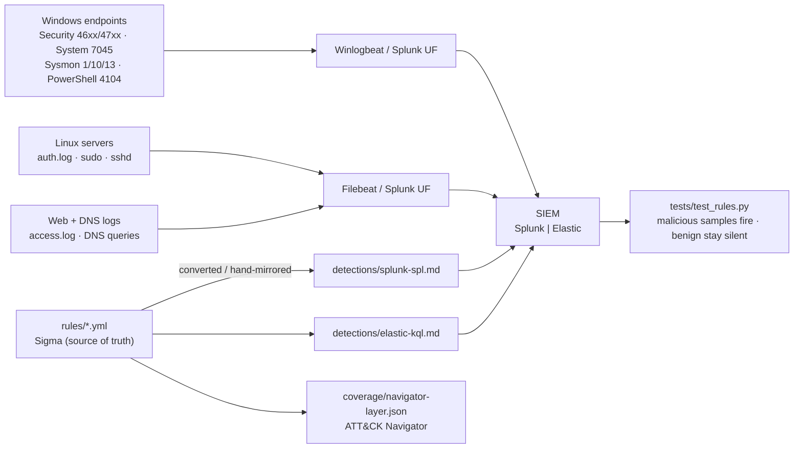

# SOC Detection Engineering Lab — Detection-as-Code (Sigma, Splunk, Elastic)

> Detection content written, tested, and versioned like code: **12 Sigma rules** covering 13 MITRE ATT&CK techniques, each with a **Splunk SPL** and an **Elastic KQL** equivalent, sample logs that prove the rules fire, a benign corpus that proves they stay quiet, and an automated test harness that runs both checks in CI-style.

**Author:** Gilberto A. Cedillo Soto (Abisaíd) — Cybersecurity senior, BYU–Idaho (Class of 2027) · GitHub: [@gilbertocedillo](https://github.com/gilbertocedillo)
`Sigma` · `Splunk SPL` · `Elastic KQL` · `Sysmon` · `Windows Event Logs` · `MITRE ATT&CK` · `Python`

## Why this project exists

Alert triage is where SOC analysts start; **detection engineering is what separates a button-clicker from an analyst who understands telemetry**. My automation projects (AWS SOC, DevSecOps, honeypot, AI gateway) generate and respond to alerts — this lab is the layer underneath: hand-written, ATT&CK-mapped detection logic with explicit false-positive reasoning and regression tests for every rule.

## Lab architecture



## Rule index

| # | Rule | ATT&CK | Log source | Level |
|---|---|---|---|---|
| 01 | [LSASS Memory Access from Non-System Process (Sysmon 10)](rules/01_lsass_credential_dumping_sysmon.yml) | T1003.001 | sysmon | high |
| 02 | [PowerShell Encoded or Obfuscated Command Execution](rules/02_powershell_encoded_command.yml) | T1059.001 | powershell | high |
| 03 | [PsExec-Style Lateral Movement Service Creation (7045)](rules/03_psexec_lateral_movement_service.yml) | T1021.002 | system | high |
| 04 | [Kerberoasting - Service Ticket Request with RC4 Encryption (4769)](rules/04_kerberoasting_spn_ticket_rc4.yml) | T1558.003 | security | medium |
| 05 | [DCSync - Directory Replication from Non-DC Account (4662)](rules/05_dcsync_directory_replication.yml) | T1003.006 | security | critical |
| 06 | [Pass-the-Hash Style Logon - Explicit Credentials (4648 / 4624 Type 9)](rules/06_pass_the_hash_explicit_logon.yml) | T1550.002 | security | high |
| 07 | [Scheduled Task Creation with Suspicious Content (4698)](rules/07_scheduled_task_persistence.yml) | T1053.005 | security | medium |
| 08 | [Registry Run Key Persistence via Sysmon (Event ID 13)](rules/08_registry_run_key_persistence.yml) | T1547.001 | sysmon | medium |
| 09 | [Linux SSH Brute Force - Multiple Failed Passwords](rules/09_linux_ssh_brute_force.yml) | T1110.001 | sshd | medium |
| 10 | [Linux Sudo Access to Shadow File or Root Shell](rules/10_linux_sudo_shadow_root_shell.yml) | T1003.008, T1548.003 | sudo | high |
| 11 | [Possible DNS Tunneling - Abnormally Long Subdomain Queries](rules/11_dns_tunneling_long_subdomains.yml) | T1071.004 | dns | medium |
| 12 | [Web Exploitation Attempt - SQL Injection or Web Shell in Access Logs](rules/12_web_sqli_webshell_access.yml) | T1190 | httpd | high |

Full coverage matrix: [coverage/mitre-coverage.md](coverage/mitre-coverage.md) · Navigator layer: [coverage/navigator-layer.json](coverage/navigator-layer.json)

## Run the tests

```bash
pip install pyyaml            # only dependency (pytest optional)
python3 scripts/validate_rules.py   # structure: fields, UUIDs, tags -> 12/12 PASS
python3 tests/test_rules.py         # behaviour: 14 tests, built-in runner
# or, if you have pytest:  pytest tests/ -q
```

What the harness proves:
- Every rule parses, carries the required Sigma fields, a unique UUID, and a well-formed `attack.tXXXX(.NNN)` tag.
- **All 12 rules fire** on the malicious sample corpus (`sample-logs/`), not just the required six.
- **Zero rules fire** on the benign corpus (`sample-logs/benign-sample.log`): normal Kerberos logons, a legitimate PowerShell backup script, a Google Update service install, one mistyped SSH password, an `apt`-style sudo status check, short DNS names, ordinary web browsing.
- SPL/KQL docs and the Navigator layer cover exactly the techniques the rules claim — no documentation drift.

> The matcher in `tests/matcher.py` is a deliberately lightweight stand-in for a Sigma backend (field/keyword logic per selection, SSH brute-force as a counting rule at >=10 failures/5 min/IP). In a real deployment you would convert with pySigma into Splunk/Elastic and alert in the SIEM; the SPL/KQL in `detections/` are those production forms.

## Telemetry requirements (what you must turn on first)

| Rule group | Prerequisite |
|---|---|
| Sysmon rules (1, 8) | Sysmon installed with a config capturing ProcessAccess (10) and RegistryEvent (13) |
| Kerberoasting / DCSync / PtH (4, 5, 6) | Advanced Audit Policy: Kerberos Service Ticket Operations, Directory Service Access (4662 requires the right SACLs on the domain object) |
| Scheduled task (7) | Audit Other Object Access Events / Security 4698 enabled |
| PowerShell (2) | Script Block Logging (4104) + Process Creation auditing (4688) with command line |
| Linux (9, 10) | auth.log shipped with sshd/sudo logging intact |
| DNS (11) | DNS query logging (resolver, Sysmon 22, or Zeek dns.log) |

A detection is only as good as its telemetry — half of each rule's value is documented in its `falsepositives` and the tuning notes in the SPL/KQL.

## Repo layout

```
rules/          12 Sigma rules (source of truth)
detections/     Splunk SPL + Elastic KQL, numbered to match rules/
coverage/       ATT&CK coverage matrix + Navigator layer JSON
sample-logs/    malicious corpora (Windows JSONL, Linux, web, DNS) + benign corpus
tests/          matcher.py (lightweight Sigma-selection stand-in) + 14 tests
scripts/        validate_rules.py — standalone structural validator
docs/           sample L2 triage report + interview defense guide
```

## Coverage summary

13 techniques / 7 tactics, depth-first on **Credential Access (5 rules)**, Persistence, and Lateral Movement — see [coverage/mitre-coverage.md](coverage/mitre-coverage.md) for the matrix and the honest gaps list.

## Roadmap

- [ ] Sysmon EID 1 process-creation pack (Office->shell, certutil download, rundll32 abuse)
- [ ] Convert rules in CI with pySigma and fail the build on conversion errors
- [ ] Add Zeek/Suricata network detections (beaconing, JA3 anomalies)
- [ ] Replay an Atomic Red Team run per rule and archive the generated logs as fixtures

## License

MIT — see [LICENSE](LICENSE). Sample logs are synthetic and contain no real credentials or personal data; hostnames, users and IPs are fictional or documentation ranges (RFC 5737).
